

# InstHush

**Ghost mode, video tools and downloads for Instagram on the web.** 
Everything runs on your device: no account, no tracking.

   

[Türkçe](README.tr.md) · [Privacy policy](PRIVACY.md) · [Report an issue](../../issues)

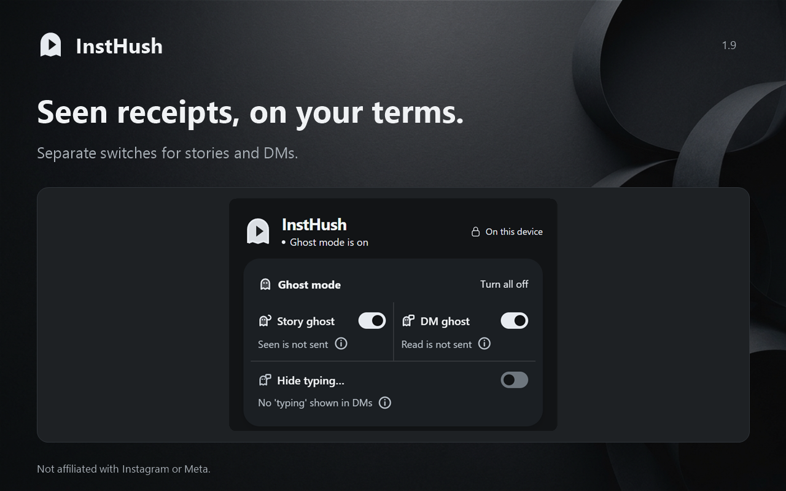

> InstHush is not affiliated with, endorsed by or sponsored by Instagram or Meta. "Instagram" is a trademark of Meta Platforms, Inc.

## Watch

*Click to watch on YouTube.*

## At a glance

<table>
<tr>
<td width="50%">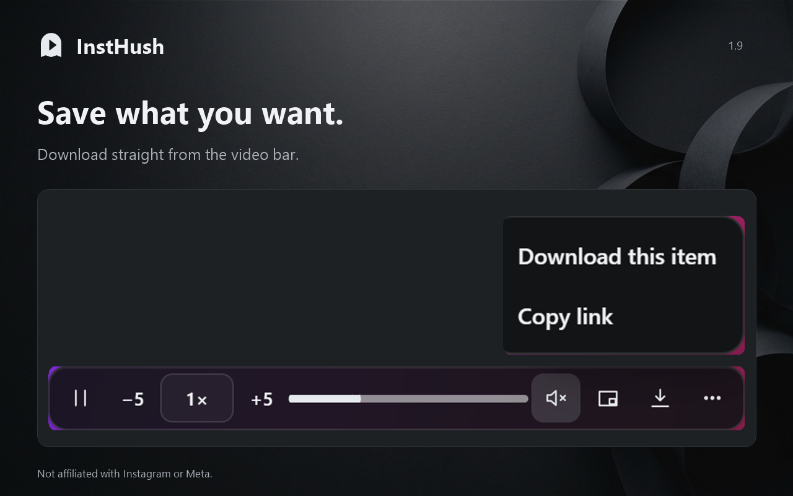</td>
<td width="50%">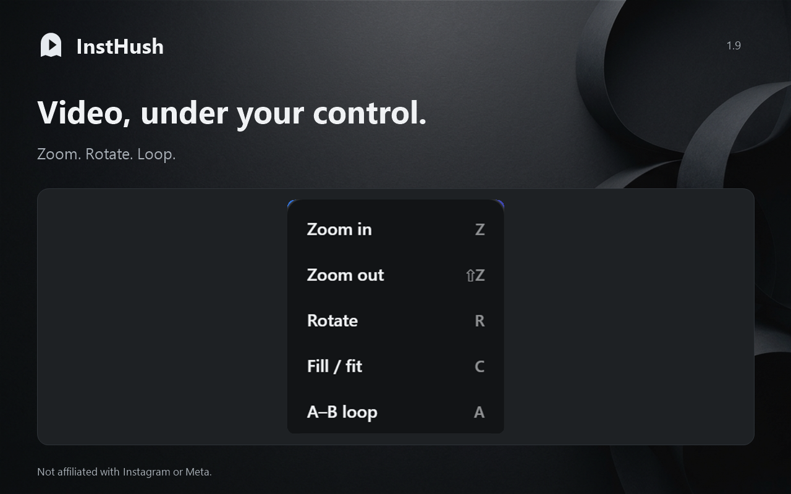</td>
</tr>
<tr>
<td width="50%">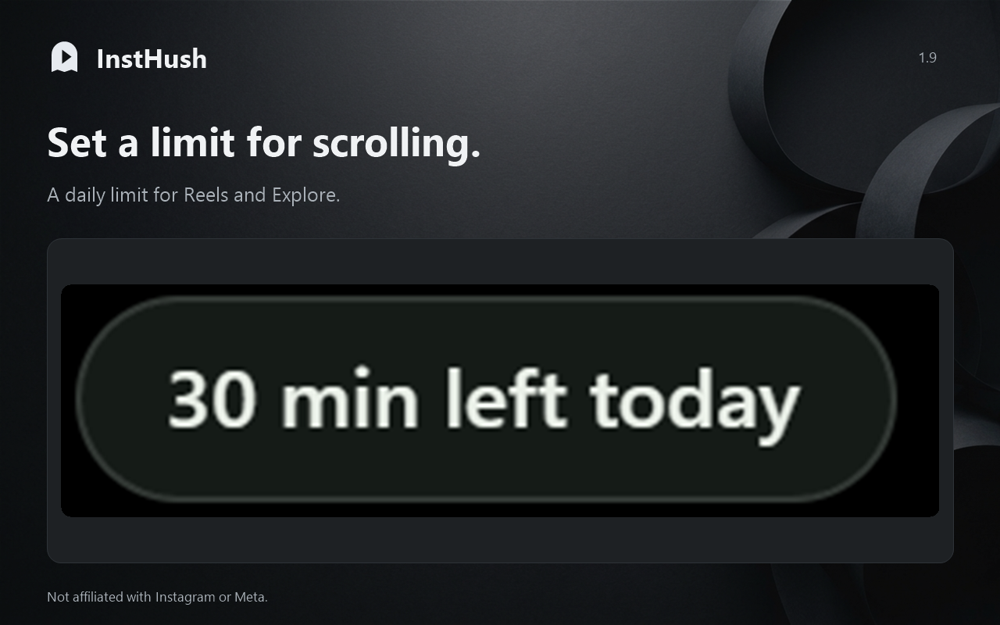</td>
<td width="50%">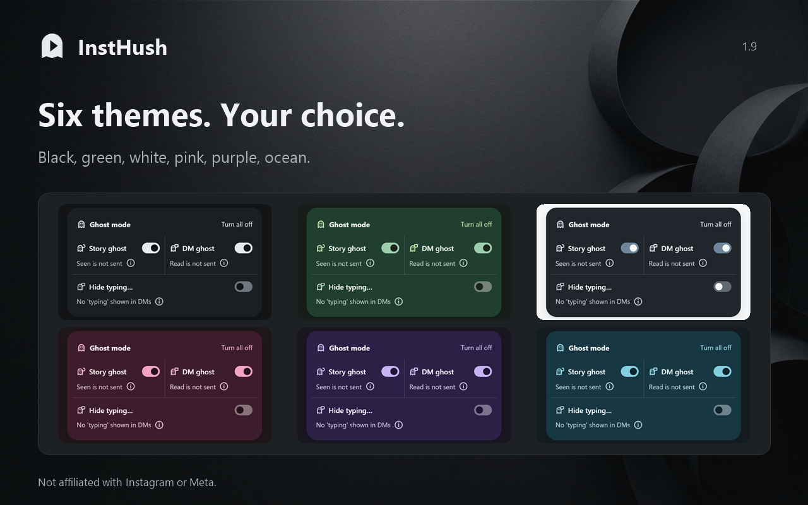</td>
</tr>
</table>

Works in Chrome, Brave, Edge, Firefox, Zen and LibreWolf. Open source (GPL-3.0-only), plain JavaScript, no build step. The screenshots in this page come from local test pages with made-up accounts such as `hesap_a`, never from a real account.

## Install

<!-- store-links -->
 

**Chrome, Brave, Edge:** install from the [Chrome Web Store](https://chromewebstore.google.com/detail/insthush/kaddhdoafgbognkagpddomhkhmngjjia). The manual steps below are only needed for unpacked builds.

**Firefox, Zen, LibreWolf:** install from [Firefox Add-ons](https://addons.mozilla.org/firefox/addon/insthush/).

**Chrome, Brave, Edge**

1. Download `InstHush-chrome-v1.9.0.zip` from the [Releases page](../../releases/latest) and extract it.
2. Open `chrome://extensions` (or `brave://extensions`, `edge://extensions`) and enable **Developer mode**.
3. Choose **Load unpacked** and pick the extracted `InstHush-Chrome` folder.

**Firefox, Zen, LibreWolf (128+)**

Until the Firefox Add-ons listing is live:

1. Download `InstHush-firefox-v1.9.0.zip` from the [Releases page](../../releases/latest).
2. Open `about:debugging#/runtime/this-firefox`, choose **Load Temporary Add-on** and pick the downloaded zip.
3. A temporary add-on is removed when Firefox restarts, so you have to load it again after a restart.

Browser differences

- Zoom and pan are hidden when `object-view-box` is unavailable (including Firefox 128); rotation and fill/fit remain.
- The picture-in-picture button, menu item and shortcut need `requestPictureInPicture`. Firefox's own PiP controls still work.
- Without `OffscreenCanvas`, the toolbar uses the packaged green icon instead of the selected theme.
- Without video frame callbacks, A–B looping uses `timeupdate` and is less precise.
- MP3 conversion uses an offscreen document on Chromium and runs in the background page on Firefox.

## Features

Most switches live in three places: the **Settings** page, the toolbar **popup** and the in-page **dock** (Alt + G). New installs use the black theme.

### Ghost mode

Read stories and messages without sending the "seen" signal.

- Story and DM "seen" signals are blocked while ghost mode is on, with a separate switch for each.
- **Hide typing** (off by default) drops the outgoing "typing..." indicator in DMs. It only recognizes the request formats it knows.
- **Mark as read** sits in the DM header and lets the next read receipt for that chat through when you choose.
- Protection depends on Instagram's current request formats and can break when Instagram changes them.

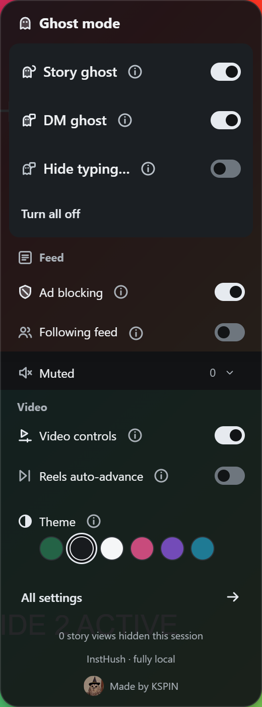 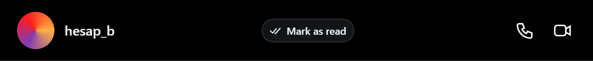

### Downloads

Save what you want, with names you choose.

- **Video bar download menu**: download the current item, download all items of a carousel or story set, copy the media link, optionally convert a video's sound to MP3.
- **Photo hover toolbar**: download, view full size, copy the link and more, right on the photo.
- Files go through direct CDN links, so download managers can catch them. Carousels and sets arrive as one ZIP by default (a setting switches to separate files).
- **Filename template** with folders, for example `InstHush/{user}/{user}_{date}_{shortcode}_{index}`, validated in Settings with a live example.
- **Right-click download** from the browser's context menu (on by default), a save button beside **comment GIFs** (on by default) and **voice message** download in DMs (off by default).
- **Bulk download** of a profile or of saved posts is off by default, asks for consent and pauses between requests.
- MP3 is off by default. The first time you use it, the extension asks for the optional permission to read Instagram's CDN hosts.

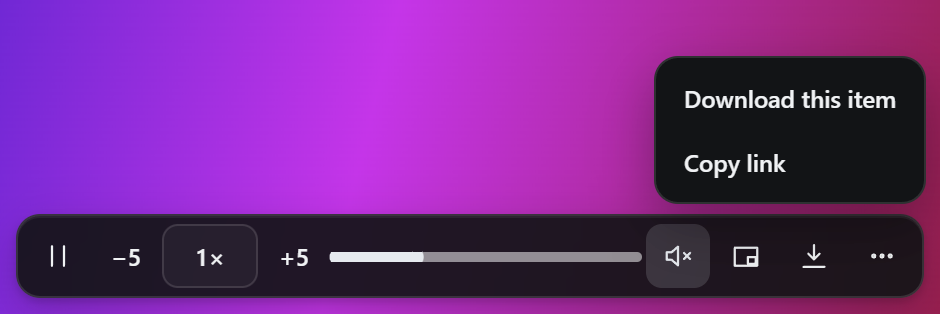 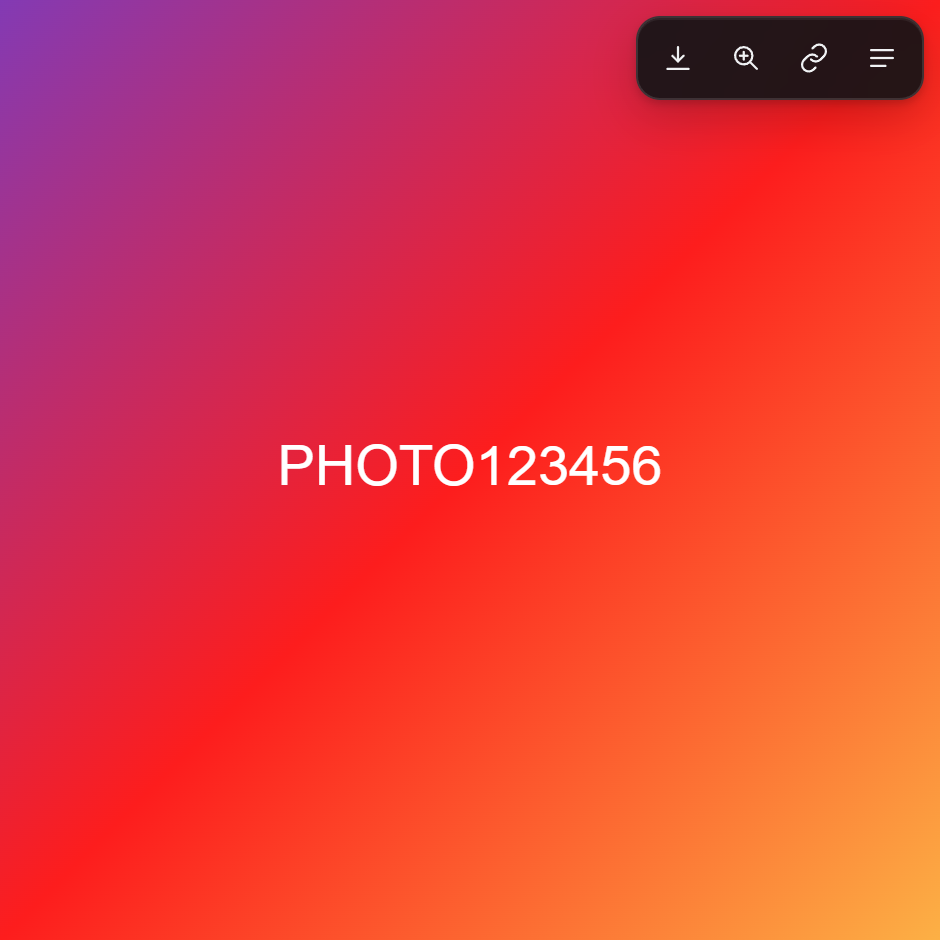

### Video controls

- Playback speed, seek ±5 seconds, zoom and pan, rotate, fill/fit, A–B loop, frame stepping, PNG frame capture, picture-in-picture.
- Sound preferences are remembered. Optional Reels auto-advance. Default speed (0.75× to 2×) for each new video; a speed you pick on a video wins for that video.
- Off by default: **Feed autoplay off** and **Story auto-pause**. **Stop at story end** (off) waits for you before the next story.

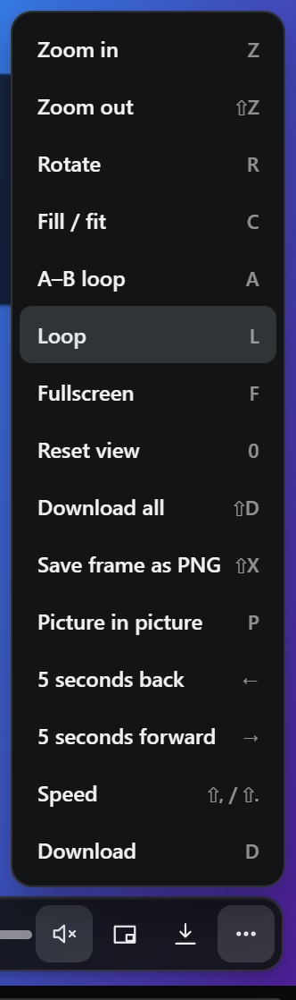 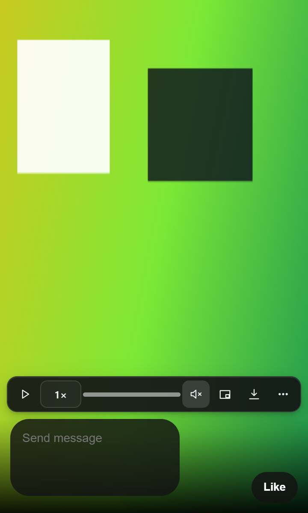

### Profile and followers

- **Follows you** badge on a profile with four states: mutual, follows you, doesn't follow you, you don't follow. Click it for a details panel. On by default.
- **Unfollowers panel** (off by default): scans your own followers and following in small, paced steps, compares scans over time (who unfollowed you, new followers), keeps a keep list and exports CSV.
- Profile photo download in full size from the dock or by hovering the avatar.

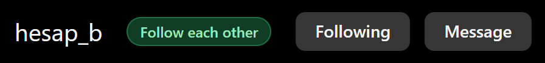 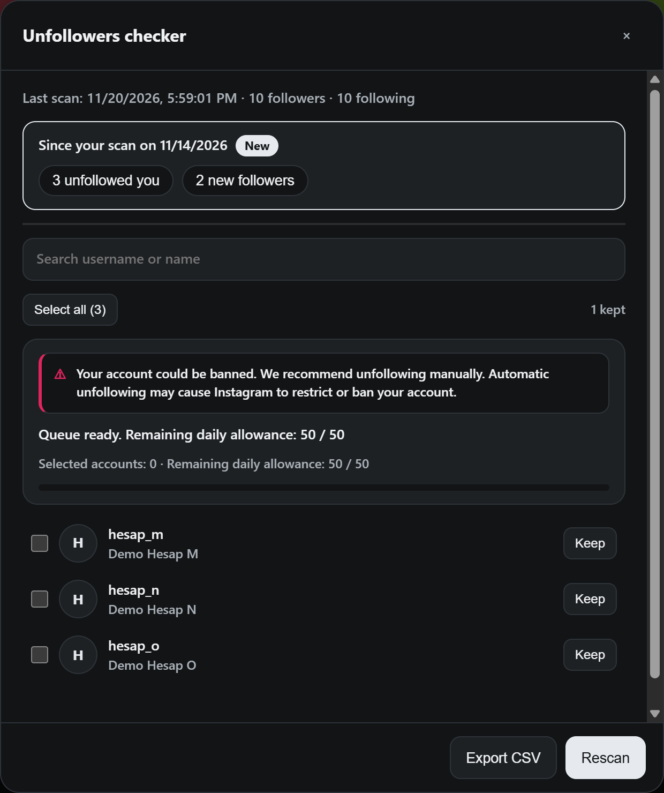

> **Risk, said plainly:** the optional **unfollow queue** acts on your account through Instagram's own web requests. Instagram can restrict or ban accounts that unfollow in bulk, even slowly. Manual unfollowing is the safe choice, and the queue is off by default and behind a consent step. Use it at your own risk.

### Stories

- **Story details** button on a story lists mentions, hashtags, places, links, stickers and music that Instagram sent with it.
- Story view signals stay hidden while story ghost mode is on.

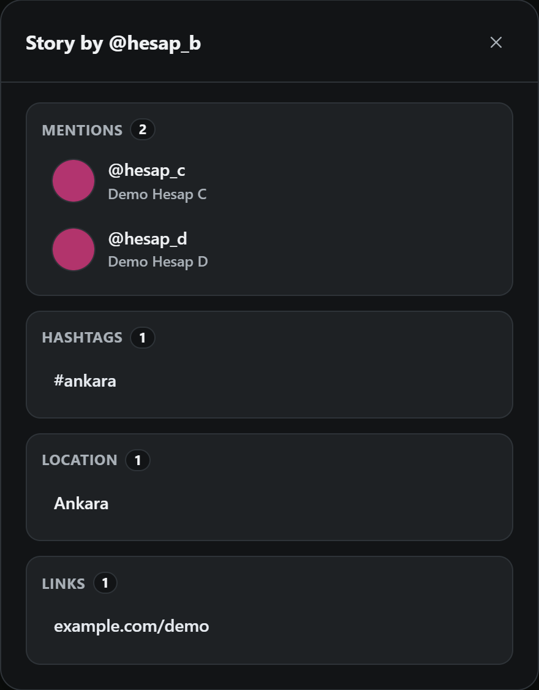

### Direct messages

- Photos and videos in a thread get the download button (small images such as avatars and stickers are skipped; videos Instagram plays from a `blob:` source cannot be fetched).
- **Keep unsent messages** (off, asks for consent) stores messages the other person unsends on your device for up to 30 days; you can clear them from the chat.
- Voice message download (see Downloads).

### A calmer feed and focus

Remove what you do not want to see. All of it runs locally.

- **Ad filter**: sponsored items are removed from Instagram's own responses before the page shows them, including Reels ads. No blocklist is downloaded.
- **Local mute** for words, hashtags and accounts (Turkish-aware, up to 100 entries per list).
- **Focus options**, each off by default: hide counts, suggested posts, suggested accounts, the story row, Reels and Explore links, Threads promos, Reels in the home feed, Meta AI. Plus **open home as "Following"** and **dim seen posts**.
- **Daily limit** for Reels and Explore: a small pill shows the time left, optional grayscale when time runs out, and a counter of distinct reels watched today.
- **No double-tap like** stops accidental likes from a double click on media.
- **Time on Instagram** and an optional break reminder in the popup and dock.

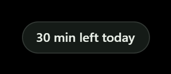

### Settings and themes

The **Settings** page groups everything into Privacy, Feed, Video, Downloads, Profile and stories, Focus, Appearance and Tools, with a search box that understands synonyms in Turkish and English. Six themes (green, black, white, pink, purple, ocean); the toolbar icon follows the theme. **Export** and **Import** back up your settings as JSON.

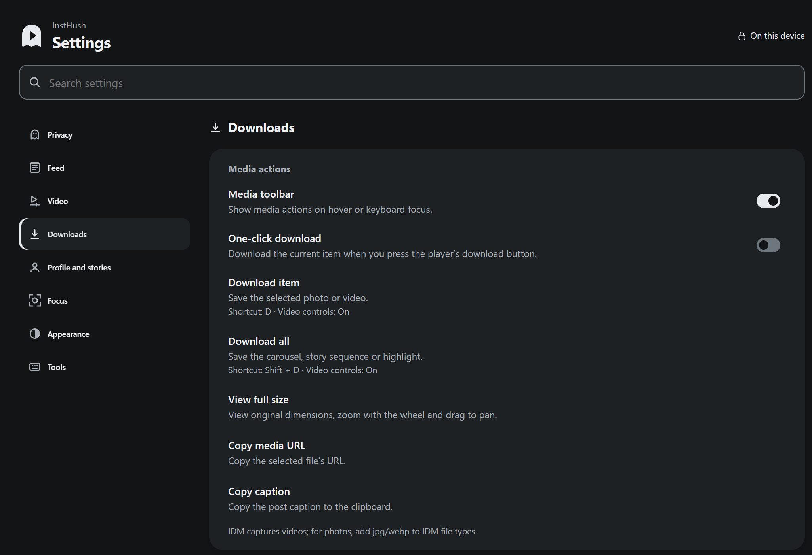 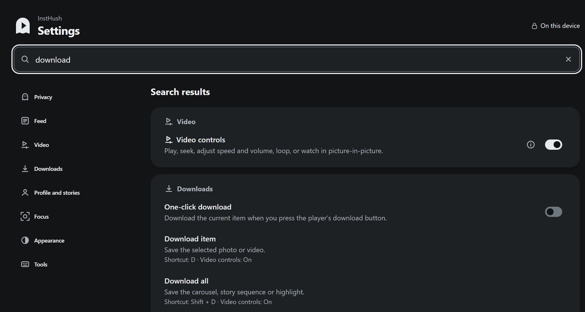

| Green | Black | White |
|---|---|---|
| 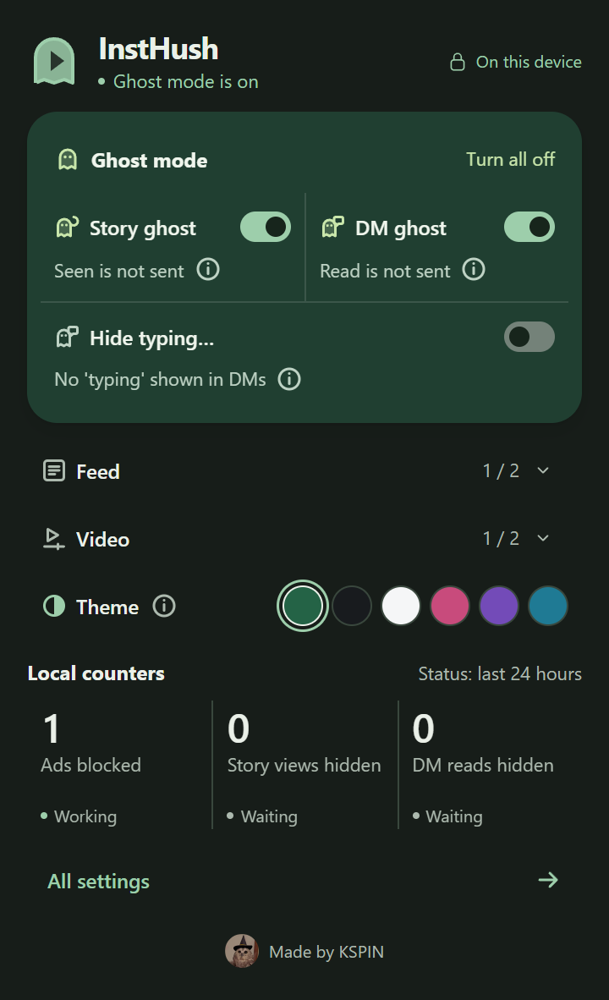 | 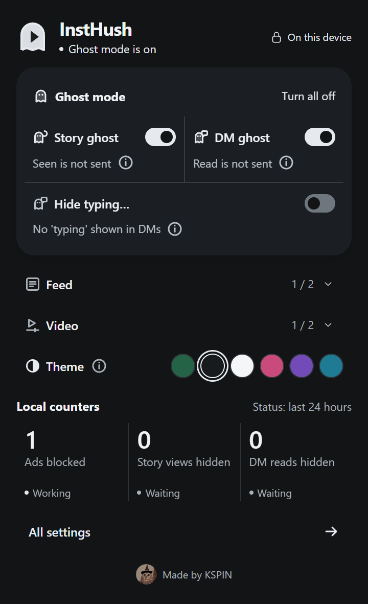 | 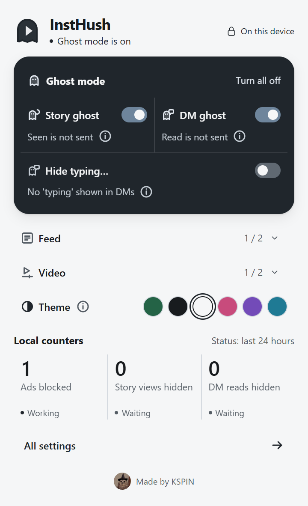 |
| **Pink** | **Purple** | **Ocean** |
| 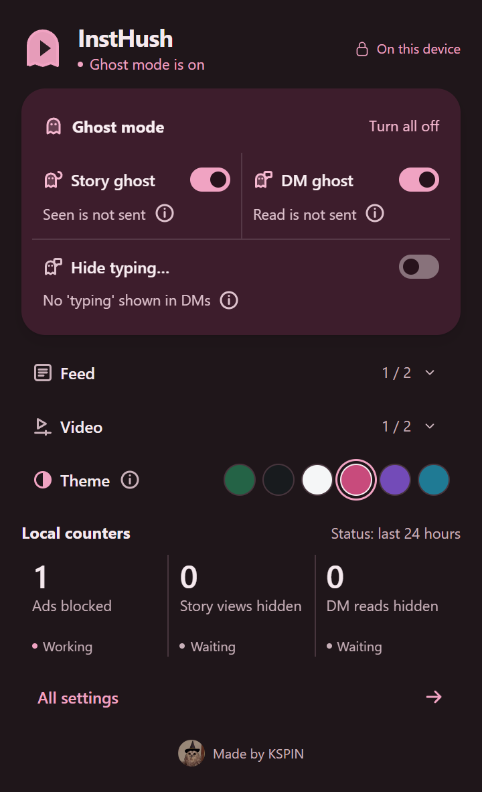 | 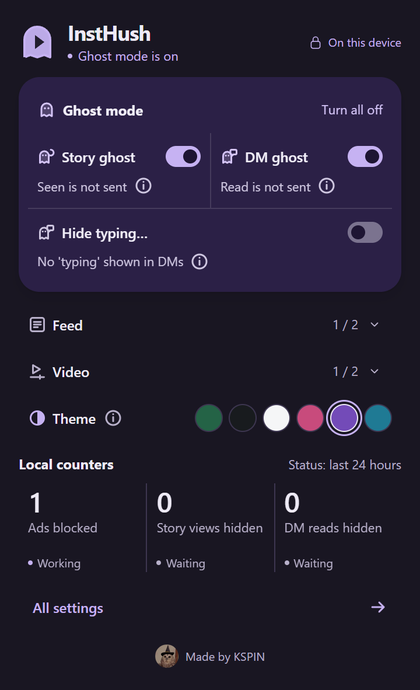 | 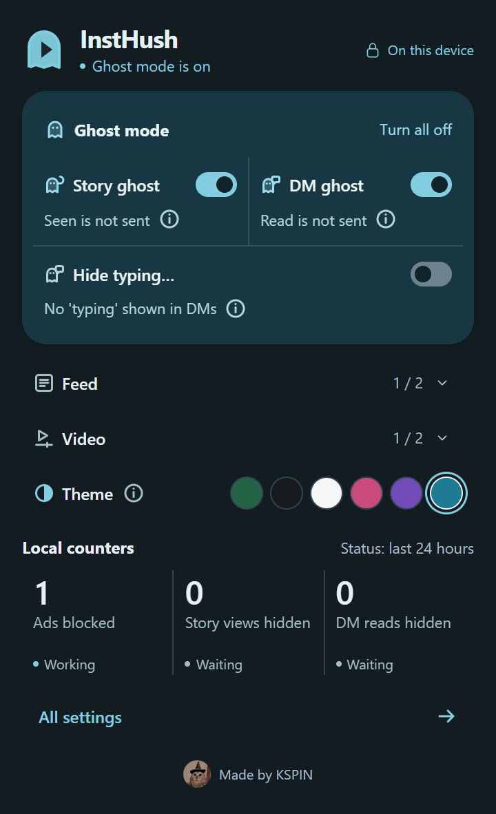 |

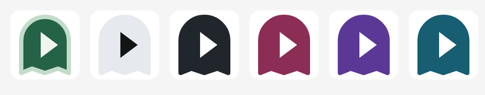

### Small helpers

- **Comment copy** button under supported comments and on captions: copies the text without the author name.
- **Post author** badge on the author's own comments (on by default).
- **Exact dates** next to relative times (off by default).
- **Clean share links**: copied links lose tracking parameters; an optional share domain replaces `instagram.com` in copied links.
- **Direct links** skip the `l.instagram.com` redirect (off by default). **Analytics block** drops recognized usage-analytics requests (off by default).
- **Grid hover preview** on profile and Explore grids (off by default).
- **Favorites**: star accounts and open them from the popup.

## Keyboard shortcuts

All shortcuts

Video shortcuts work on the active video; typing in text fields never triggers a shortcut. Press `?` on Instagram for the full list. Post navigation and the help list can be turned off with the **Keyboard shortcuts** setting.

| Action | Key |
|---|---|
| In-page dock | Alt + G |
| Next / previous post | J / K |
| Shortcut help | ? |
| Playback speed | Shift + . / Shift + , |
| Seek ±5 seconds | ← / → |
| Loop video | L |
| Capture frame | Shift + X |
| Picture-in-picture | P |
| Download the current post (visible slide) | D |
| Download all items of the current post | Shift + D |
| Volume | ↑ / ↓ |
| Zoom in / out | Z / Shift + Z |
| Reset view | 0 |
| Rotate | R |
| Fill / fit | C |
| A–B loop | A |
| Fullscreen | F |
| Hold for 2× speed | S |
| Previous / next frame | , / . |

In the feed, D works on the post you last jumped to with J / K, or else the most visible post. In a post dialog, J / K use the dialog's own next/previous buttons.

## How well is it tested?

Version 1.9 is covered by offline unit tests and end-to-end checks in headless Brave against local test pages. It also had one read-only check on a real signed-in account (nothing liked, followed, posted or unfollowed, and no chat was opened). That check found problems with some feed filters on the "For you" feed and with story details, and fixes were made afterwards but **not re-checked on the real site**. DM "seen" blocking, MP3 conversion, the unfollow queue and bulk download were not exercised live. If a feature does nothing, Instagram's page may differ from what the extension expects.

## Privacy and permissions

Nothing is sent to the developer or to any third party. There is no account, no telemetry, no analytics and no external backend. Full text: [PRIVACY.md](PRIVACY.md).

- **Stored on your device** (`chrome.storage.local`): settings, favorites, counters, daily time totals, your mute and keep lists, scan results for the unfollowers panel, and, if you turn them on, seen-post identifiers and unsent messages. Media and comments are not saved there.
- **Network**: the extension talks only to Instagram. Downloads ask Instagram's own endpoints for the media URL with your existing session, and the browser fetches the file from Instagram's CDN. The one exception is MP3, which needs an optional permission for the CDN hosts (see below).
- **No remote code** is loaded and no blocklist is downloaded.

| Permission | Reason |
|---|---|
| `storage` | Save settings and local data. |
| `downloads` | Save requested media, ZIP files and captured PNG frames. |
| `contextMenus` | The right-click download item. |
| `scripting` | Load a feature's files only when it is first needed, which keeps Instagram fast. |
| `offscreen` (Chromium only) | Convert audio to MP3 in a hidden document. |
| Host `https://www.instagram.com/*` | Run on Instagram pages. |
| Optional hosts: `*.cdninstagram.com`, `*.fbcdn.net`, `lookaside.fbsbx.com` | Requested only when you use MP3 conversion, to read the audio file. |

No other host permissions and no externally accessible resources are declared. The author link opens the author's GitHub profile only when clicked.

## Disclaimer

InstHush is not affiliated with, endorsed by or sponsored by Instagram or Meta. Use at your own risk and follow Instagram's terms. Instagram changes may break features, including ghost mode and ad filtering. Automatic unfollowing can get an account restricted or banned.

## License

GPL-3.0-only. See [LICENSE](LICENSE) and [NOTICE](NOTICE). InstHush adapts parts of [Glassgram](https://github.com/jewdev/glassgram) (GPL-3.0). The MP3 encoder is [lamejs](https://github.com/zhuker/lamejs) (LGPL-3.0), bundled unmodified in `src/vendor/`.
