# InstHush

**Web üzerindeki Instagram için gizli mod, video araçları ve indirme. Her şey cihazınızda çalışır: hesap yok, takip yok.**

[English](README.md) · [Gizlilik politikası](PRIVACY.md)

> InstHush; Instagram veya Meta ile bağlantılı değildir, onlar tarafından onaylanmamış veya desteklenmemiştir. “Instagram”, Meta Platforms, Inc. şirketinin ticari markasıdır.

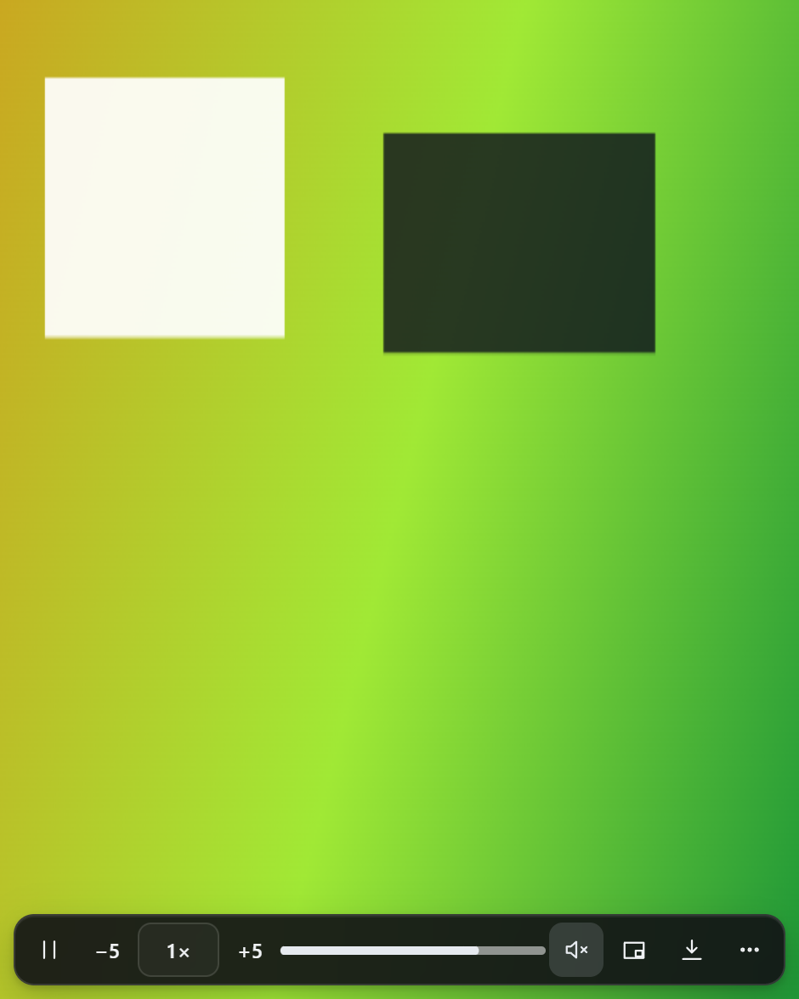

Chrome, Brave, Edge, Firefox, Zen ve LibreWolf'ta çalışır. Açık kaynak (GPL-3.0-only), düz JavaScript, derleme adımı yok. Bu sayfadaki ekran görüntüleri, `hesap_a` gibi uydurma hesaplar içeren yerel test sayfalarından alınmıştır; gerçek bir hesaptan değil.

## Kurulum

<!-- store-links -->

**Chrome, Brave, Edge:** [Chrome Web Store](https://chromewebstore.google.com/detail/insthush/kaddhdoafgbognkagpddomhkhmngjjia) üzerinden yükleyin. Aşağıdaki elle kurulum adımları yalnızca paketlenmemiş sürüm için gerekir.

**Chrome, Brave, Edge**

1. `InstHush-chrome-v1.9.0.zip` dosyasını [Sürümler sayfası](../../releases/latest)ndan indirip çıkarın.
2. `chrome://extensions` (veya `brave://extensions`, `edge://extensions`) adresini açıp **Geliştirici modu**'nu etkinleştirin.
3. **Paketi açılmış öğe yükle** düğmesine tıklayıp çıkardığınız `InstHush-Chrome` klasörünü seçin.

**Firefox, Zen, LibreWolf (128+)**

Firefox Add-ons listesi yayınlanana kadar:

1. `InstHush-firefox-v1.9.0.zip` dosyasını [Sürümler sayfası](../../releases/latest)ndan indirin.
2. `about:debugging#/runtime/this-firefox` adresini açın, **Load Temporary Add-on** (Geçici eklenti yükle) seçeneğini seçin ve indirdiğiniz zip dosyasını gösterin.
3. Geçici eklenti Firefox yeniden başlatılınca kaldırılır; yeniden başlattıktan sonra tekrar yüklemeniz gerekir.

Tarayıcı farkları

- `object-view-box` yoksa (Firefox 128 dahil) yakınlaştırma ve kaydırma gizlenir; döndürme ve doldur/sığdır kalır.
- Resim içinde resim düğmesi, menü öğesi ve kısayolu `requestPictureInPicture` ister. Firefox'un kendi PiP kontrolleri yine çalışır.
- `OffscreenCanvas` yoksa araç çubuğu seçilen tema yerine paketteki yeşil simgeyi kullanır.
- Video kare geri çağrıları yoksa A–B döngüsü `timeupdate` kullanır ve daha az hassastır.
- MP3 dönüştürme Chromium'da gizli (offscreen) bir belgede, Firefox'ta arka plan sayfasında çalışır.

## Özellikler

Anahtarların çoğu üç yerde bulunur: **Ayarlar** sayfası, araç çubuğundaki **açılır pencere** ve sayfa içi **panel** (Alt + G). Yeni kurulumlar siyah temayla başlar.

### Gizli mod

Hikâye ve mesajları “görüldü” sinyali göndermeden okuyun.

- Gizli mod açıkken hikâye ve DM “görüldü” sinyalleri engellenir; her biri için ayrı anahtar vardır.
- **Yazıyor… gizle** (varsayılan kapalı), DM'de giden “yazıyor…” göstergesini düşürür. Yalnızca tanıdığı istek biçimlerini yakalar.
- DM başlığındaki **Okundu yap** düğmesi, istediğinizde o sohbet için bir sonraki okundu bilgisinin gitmesine izin verir.
- Koruma Instagram'ın güncel istek biçimlerine bağlıdır; Instagram değiştirirse bozulabilir.

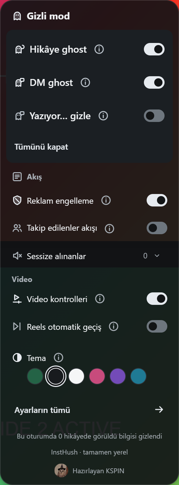 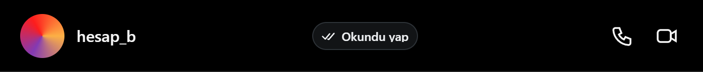

### İndirme

İstediğinizi, seçtiğiniz adlarla kaydedin.

- **Video çubuğu indirme menüsü**: geçerli öğeyi indir, albümün veya hikâye dizisinin tamamını indir, medya bağlantısını kopyala, isteğe bağlı olarak videonun sesini MP3'e çevir.
- **Fotoğraf üstünde araç çubuğu**: indir, tam boyutta aç, bağlantıyı kopyala ve daha fazlası, doğrudan fotoğrafın üzerinde.
- Dosyalar doğrudan CDN bağlantılarıyla iner, indirme yöneticileri yakalayabilir. Albümler ve diziler varsayılan olarak tek ZIP olarak gelir (bir ayar ayrı dosyaya çevirir).
- Klasörlü **dosya adı şablonu**, örneğin `InstHush/{user}/{user}_{date}_{shortcode}_{index}`; Ayarlar'da doğrulanır ve canlı örnek gösterir.
- Tarayıcının sağ tık menüsünden **sağ tıkla indir** (varsayılan açık), yorumlardaki **GIF**'in yanında kaydet düğmesi (varsayılan açık) ve DM'lerde **ses mesajı** indirme (varsayılan kapalı).
- Bir profilin veya kaydedilenlerin **toplu indirmesi** varsayılan olarak kapalıdır, onay ister ve istekler arasında bekler.
- MP3 varsayılan olarak kapalıdır. İlk kullanımda eklenti, Instagram'ın CDN adreslerini okumak için isteğe bağlı izin ister.

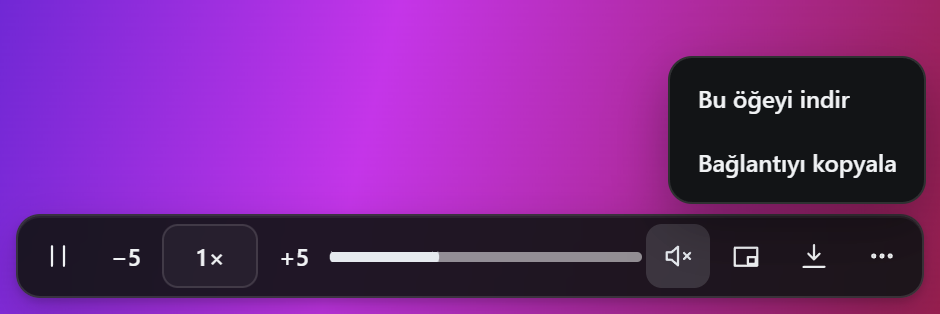 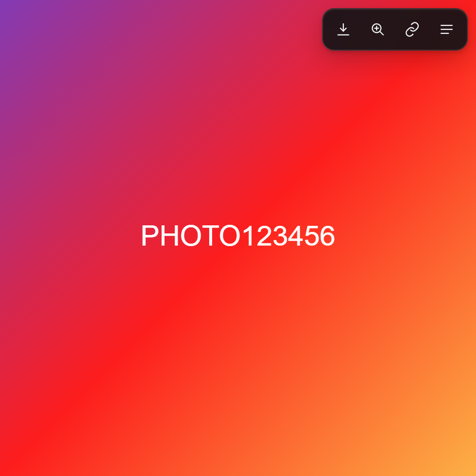

### Video kontrolleri

- Oynatma hızı, ±5 saniye atlama, yakınlaştırma ve kaydırma, döndürme, doldur/sığdır, A–B döngüsü, kare kare ilerleme, PNG kare yakalama, resim içinde resim.
- Ses tercihleri hatırlanır. İsteğe bağlı Reels otomatik ilerleme. Her yeni video için varsayılan hız (0,75× – 2×); bir videoda seçtiğiniz hız o videoda geçerlidir.
- Varsayılan kapalı: **Akışta otomatik oynatmayı kapat** ve **Hikâyeyi otomatik duraklat**. **Hikâye sonunda dur** (kapalı), sonraki hikâyeye geçmeden önce sizi bekler.

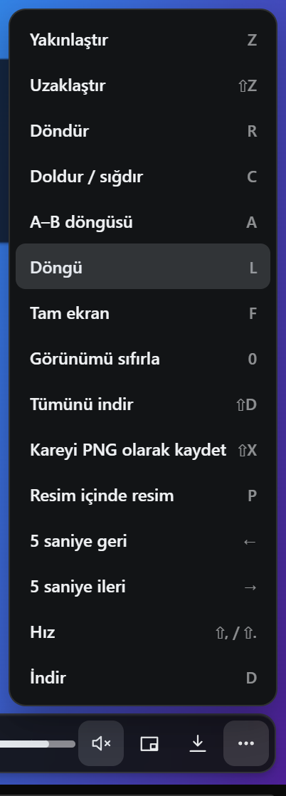 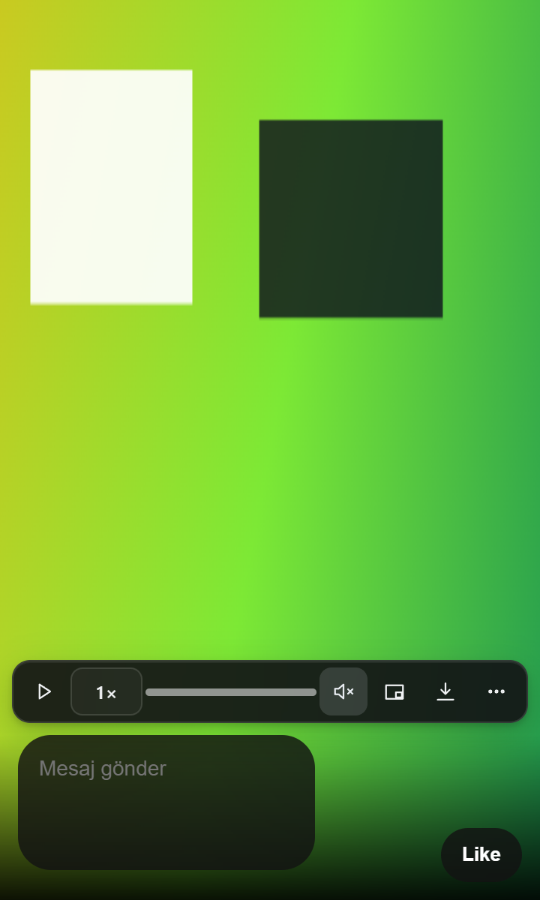

### Profil ve takipçiler

- Profilde dört durumlu **Seni takip ediyor** rozeti: karşılıklı, seni takip ediyor, seni takip etmiyor, takip etmiyorsun. Tıklayınca ayrıntı paneli açılır. Varsayılan açık.
- **Takibi bırakanlar paneli** (varsayılan kapalı): kendi takipçi ve takip ettiklerinizi küçük, aralıklı adımlarla tarar, taramaları zaman içinde karşılaştırır (kim takibi bıraktı, yeni takipçiler), koruma listesi tutar ve CSV dışa aktarır.
- Profil fotoğrafını panelden veya avatarın üstüne gelerek tam boyutta indirin.

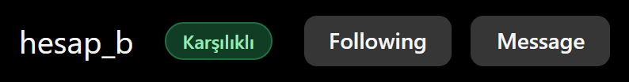 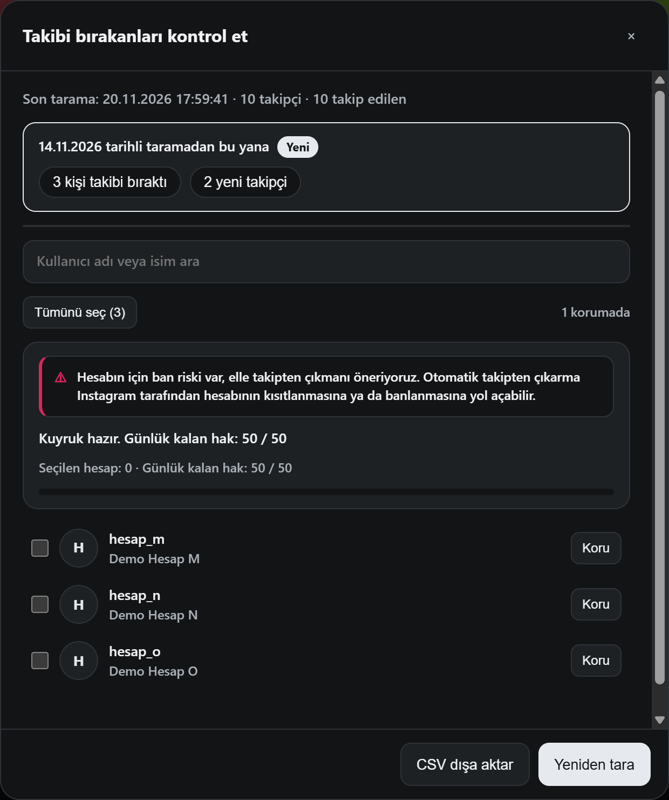

> **Risk, açıkça:** isteğe bağlı **takipten çıkma kuyruğu**, hesabınız adına Instagram'ın kendi web isteklerini kullanır. Instagram, toplu takipten çıkan hesapları yavaş da olsa kısıtlayabilir veya banlayabilir. Güvenli olan elle takipten çıkmaktır; kuyruk varsayılan olarak kapalıdır ve bir onay adımının arkasındadır. Sorumluluk size aittir.

### Hikâyeler

- Hikâyedeki **Hikâye ayrıntıları** düğmesi; Instagram'ın hikâyeyle birlikte gönderdiği bahsetmeleri, etiketleri, konumu, bağlantıları, çıkartmaları ve müziği listeler.
- Hikâye gizli modu açıkken hikâye görüntüleme sinyalleri gizli kalır.

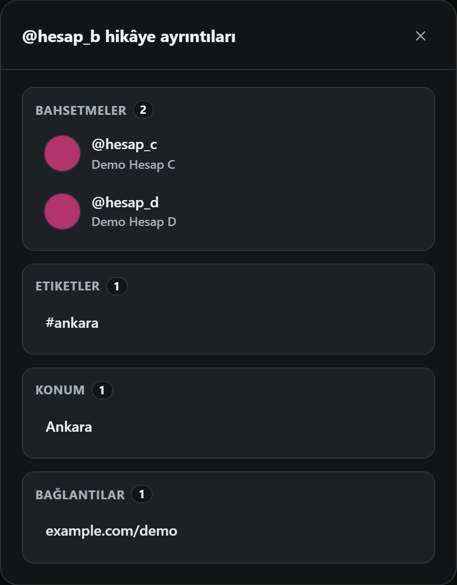

### Doğrudan mesajlar

- Bir sohbetteki fotoğraf ve videolar indirme düğmesi alır (avatar ve çıkartma gibi küçük görseller atlanır; Instagram'ın `blob:` kaynağından oynattığı videolar alınamaz).
- **Geri alınan mesajları sakla** (kapalı, onay ister), karşı tarafın geri aldığı mesajları 30 güne kadar cihazınızda tutar; sohbetten temizleyebilirsiniz.
- Ses mesajı indirme (İndirme bölümüne bakın).

### Daha sakin bir akış ve odak

İstemediğinizi görmeyin. Hepsi yerelde çalışır.

- **Reklam filtresi**: sponsorlu öğeler, sayfa göstermeden önce Instagram'ın kendi yanıtlarından çıkarılır; Reels reklamları dahil. Hiçbir engelleme listesi indirilmez.
- Kelime, etiket ve hesaplar için **yerel sessize alma** (Türkçe'ye duyarlı, liste başına en çok 100 kayıt).
- **Odak seçenekleri**, hepsi varsayılan olarak kapalı: sayıları, önerilen gönderileri, önerilen hesapları, hikâye şeridini, Reels ve Keşfet bağlantılarını, Threads tanıtımlarını, ana akıştaki Reels'i, Meta AI'ı gizle. Ayrıca **ana sayfayı “Takip ettiklerin” olarak aç** ve **görülen gönderileri soluklaştır**.
- Reels ve Keşfet için **günlük sınır**: küçük bir hap kalan süreyi gösterir, süre dolunca isteğe bağlı gri tonlama, bugün izlenen farklı reel sayısı.
- **Çift tıkla beğenmeyi engelle**, medyaya çift tıklayınca yanlışlıkla beğeni gitmesini önler.
- Açılır pencerede ve panelde **Instagram'da geçen süre** ve isteğe bağlı mola hatırlatması.

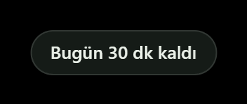

### Ayarlar ve temalar

**Ayarlar** sayfası her şeyi Gizlilik, Akış, Video, İndirme, Profil ve hikâye, Odak, Görünüm ve Araçlar altında toplar; Türkçe ve İngilizce eş anlamlıları anlayan bir arama kutusu vardır. Altı tema (yeşil, siyah, beyaz, pembe, mor, okyanus); araç çubuğu simgesi temayı izler. **Dışa aktar** ve **İçe aktar** ayarlarınızı JSON olarak yedekler.

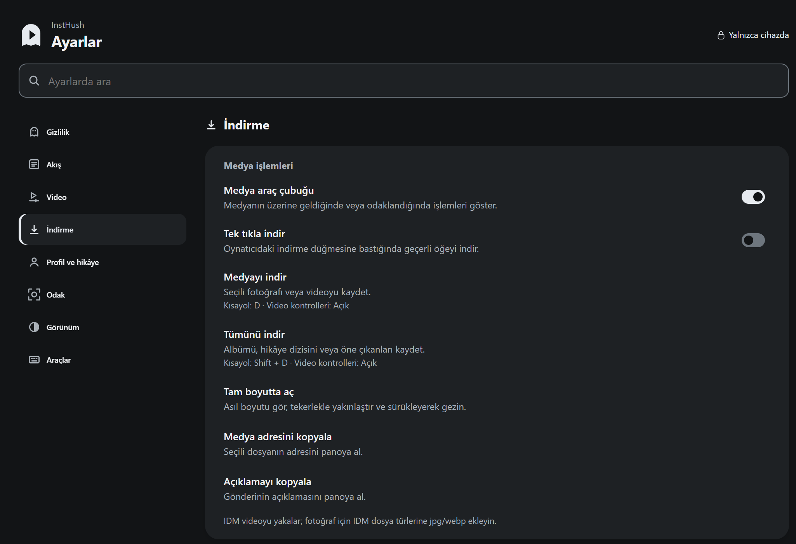 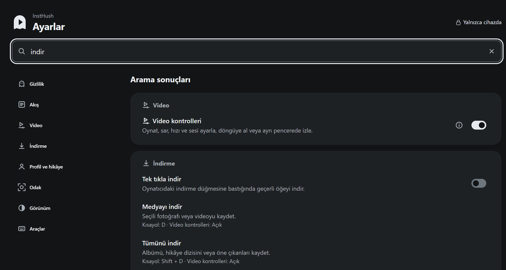

| Yeşil | Siyah | Beyaz |
|---|---|---|
| 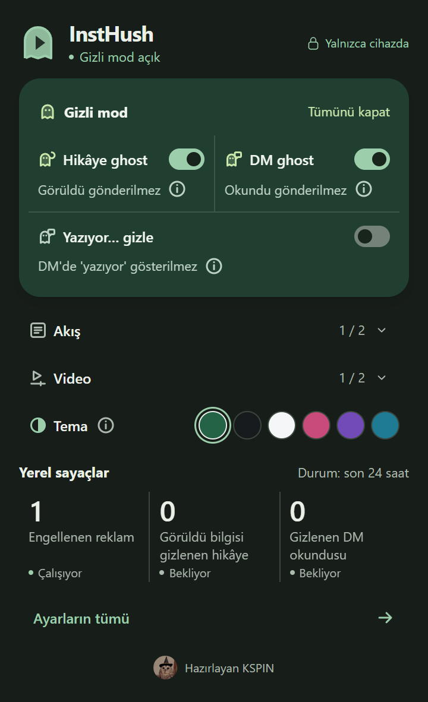 | 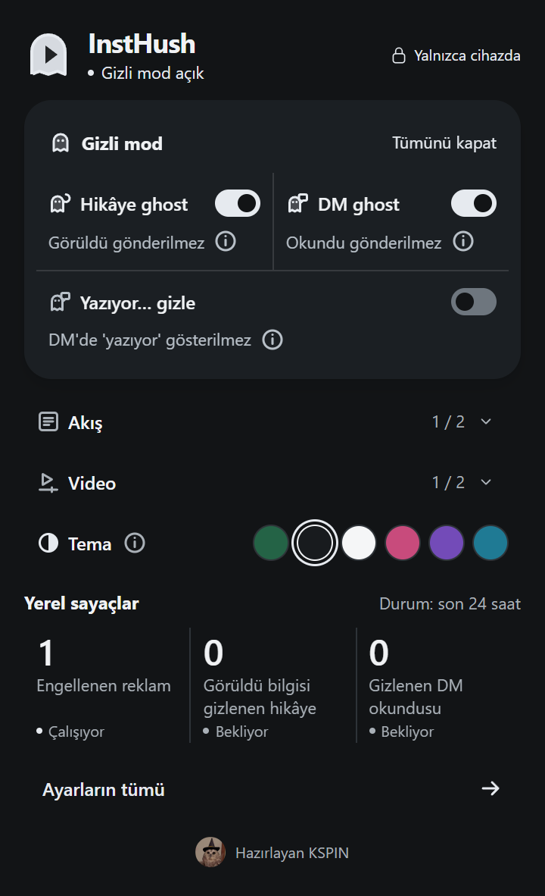 | 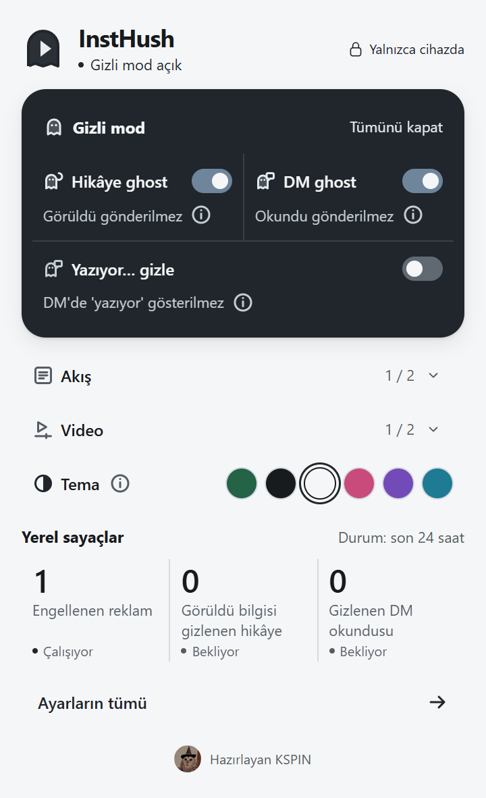 |
| **Pembe** | **Mor** | **Okyanus** |
| 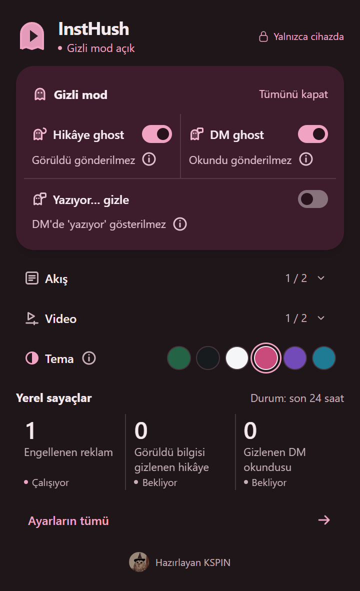 | 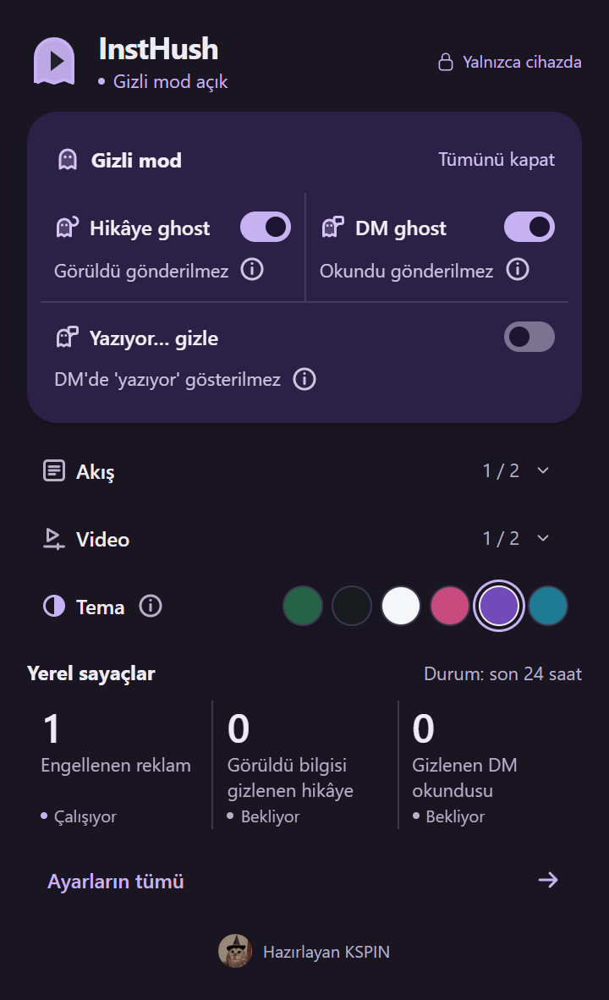 | 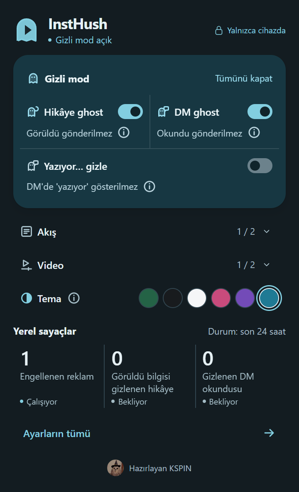 |

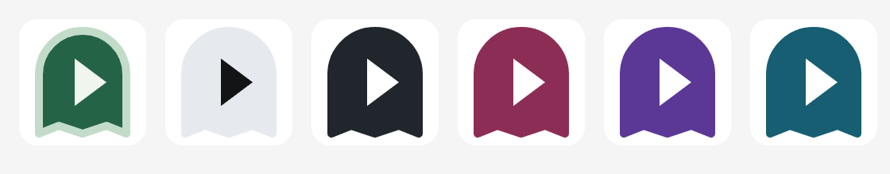

### Küçük yardımcılar

- Desteklenen yorumların altında ve açıklamada **yorum kopyala** düğmesi: metni yazar adı olmadan kopyalar.
- Gönderi sahibinin kendi yorumlarında **gönderi sahibi** rozeti (varsayılan açık).
- Göreli sürelerin yanında **tam tarih** (varsayılan kapalı).
- **Temiz paylaşım bağlantıları**: kopyalanan bağlantılar izleme parametrelerini kaybeder; isteğe bağlı paylaşım alan adı, kopyalanan bağlantılardaki `instagram.com` yerine geçer.
- **Doğrudan bağlantılar** `l.instagram.com` yönlendirmesini atlar (varsayılan kapalı). **Analitik engelleme**, tanınan kullanım analitiği isteklerini düşürür (varsayılan kapalı).
- Profil ve Keşfet ızgaralarında **ızgara üzerinde önizleme** (varsayılan kapalı).
- **Favoriler**: hesapları yıldızlayın ve açılır pencereden açın.

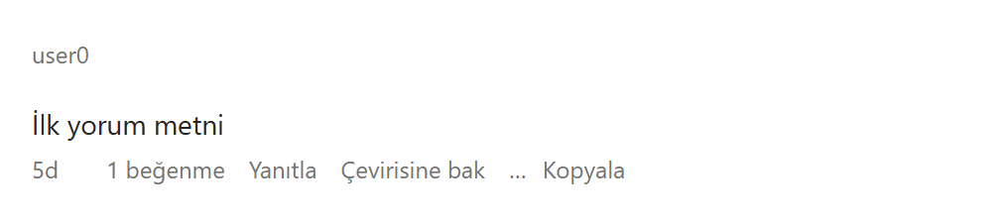

## Klavye kısayolları

Tüm kısayollar

Video kısayolları etkin videoyla çalışır; metin alanlarına yazarken hiçbir kısayol tetiklenmez. Tam liste için Instagram'da `?` tuşuna basın. Gönderi gezintisi ve yardım listesi **Klavye kısayolları** ayarıyla kapatılabilir.

| Eylem | Tuş |
|---|---|
| Sayfa içi panel | Alt + G |
| Sonraki / önceki gönderi | J / K |
| Kısayol yardımı | ? |
| Oynatma hızı | Shift + . / Shift + , |
| ±5 saniye atla | ← / → |
| Videoyu döngüye al | L |
| Kare yakala | Shift + X |
| Resim içinde resim | P |
| Geçerli gönderiyi indir (görünen slayt) | D |
| Geçerli gönderinin tüm öğelerini indir | Shift + D |
| Ses | ↑ / ↓ |
| Yakınlaştır / uzaklaştır | Z / Shift + Z |
| Görünümü sıfırla | 0 |
| Döndür | R |
| Doldur / sığdır | C |
| A–B döngüsü | A |
| Tam ekran | F |
| 2× hız için basılı tut | S |
| Önceki / sonraki kare | , / . |

Akışta D, en son J / K ile geçtiğiniz gönderide, yoksa en çok görünen gönderide çalışır. Gönderi penceresinde J / K, pencerenin kendi sonraki/önceki düğmelerini kullanır.

## Ne kadar test edildi?

1.9 sürümü, çevrimdışı birim testleri ve yerel test sayfalarına karşı başsız Brave'de uçtan uca kontrollerle denenmiştir. Ayrıca gerçek, oturum açık bir hesapta salt okunur bir kontrol yapılmıştır (hiçbir şey beğenilmedi, takip edilmedi, paylaşılmadı veya takipten çıkılmadı, hiçbir sohbet açılmadı). Bu kontrol, “Senin için” akışındaki bazı filtrelerde ve hikâye ayrıntılarında sorun buldu; sonradan düzeltmeler yapıldı ancak **gerçek sitede yeniden denenmedi**. DM “görüldü” engelleme, MP3 dönüştürme, takipten çıkma kuyruğu ve toplu indirme canlıda denenmedi. Bir özellik hiçbir şey yapmıyorsa Instagram'ın sayfası eklentinin beklediğinden farklı olabilir.

## Gizlilik ve izinler

Geliştiriciye veya üçüncü bir tarafa hiçbir şey gönderilmez. Hesap, telemetri, analitik ve harici arka uç yoktur. Tam metin: [PRIVACY.md](PRIVACY.md).

- **Cihazınızda saklananlar** (`chrome.storage.local`): ayarlar, favoriler, sayaçlar, günlük süre toplamları, sessize alma ve koruma listeleriniz, takibi bırakanlar panelinin tarama sonuçları ve açarsanız görülen gönderi tanımlayıcıları ile geri alınan mesajlar. Medya ve yorumlar burada saklanmaz.
- **Ağ**: eklenti yalnızca Instagram ile konuşur. İndirmeler, mevcut oturumunuzla Instagram'ın kendi uç noktalarından medya adresini ister ve tarayıcı dosyayı Instagram'ın CDN'inden alır. Tek istisna MP3'tür; CDN adresleri için isteğe bağlı izin ister (aşağıya bakın).
- **Uzaktan kod yüklenmez** ve engelleme listesi indirilmez.

| İzin | Neden |
|---|---|
| `storage` | Ayarları ve yerel verileri kaydetmek. |
| `downloads` | İstenen medyayı, ZIP dosyalarını ve yakalanan PNG karelerini kaydetmek. |
| `contextMenus` | Sağ tık indirme öğesi. |
| `scripting` | Bir özelliğin dosyalarını yalnızca ilk gerektiğinde yüklemek; Instagram'ı hızlı tutar. |
| `offscreen` (yalnızca Chromium) | Sesi gizli bir belgede MP3'e çevirmek. |
| Sunucu `https://www.instagram.com/*` | Instagram sayfalarında çalışmak. |
| İsteğe bağlı sunucular: `*.cdninstagram.com`, `*.fbcdn.net`, `lookaside.fbsbx.com` | Yalnızca MP3 dönüştürmeyi kullandığınızda, ses dosyasını okumak için istenir. |

Başka sunucu izni ve harici erişilebilir kaynak tanımlanmaz. Yazar bağlantısı yalnızca tıklandığında yazarın GitHub profilini açar.

## Sorumluluk reddi

InstHush; Instagram veya Meta ile bağlantılı değildir, onlar tarafından onaylanmamış veya desteklenmemiştir. Sorumluluk size aittir; Instagram'ın şartlarına uyun. Instagram değişiklikleri gizli mod ve reklam filtresi dahil özellikleri bozabilir. Otomatik takipten çıkma, hesabın kısıtlanmasına veya banlanmasına yol açabilir.

## Lisans

GPL-3.0-only. [LICENSE](LICENSE) ve [NOTICE](NOTICE) dosyalarına bakın. InstHush, [Glassgram](https://github.com/jewdev/glassgram) projesinin (GPL-3.0) bazı bölümlerini uyarlar. MP3 kodlayıcı, `src/vendor/` içinde değiştirilmeden paketlenen [lamejs](https://github.com/zhuker/lamejs) kütüphanesidir (LGPL-3.0).
